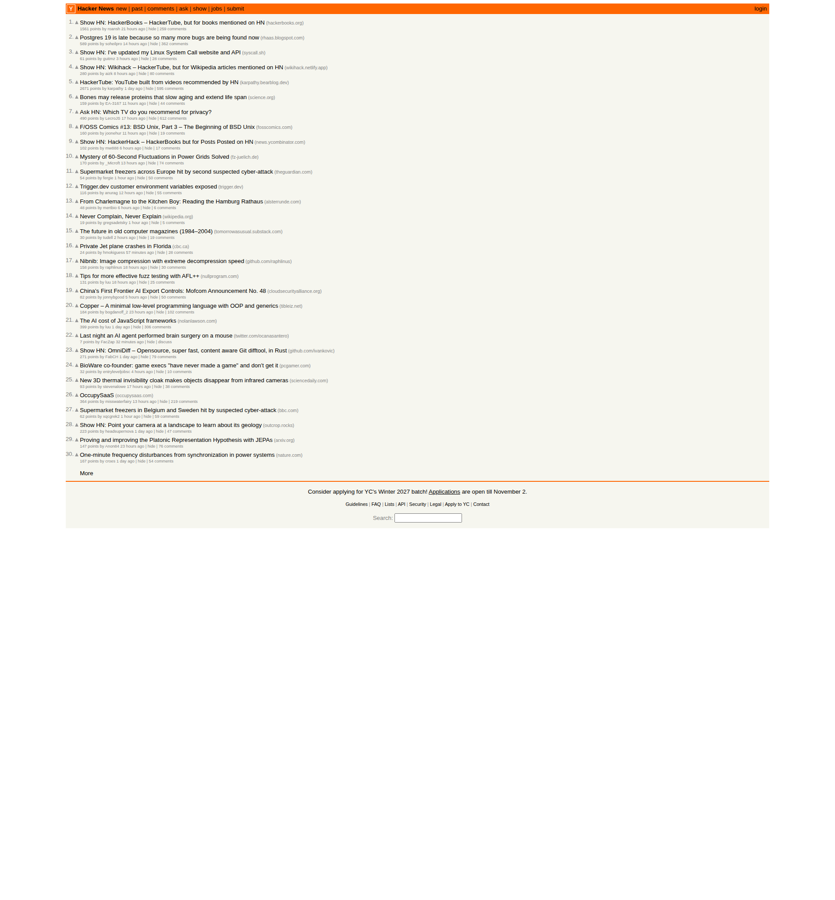

# Hacker News Trend Report — 2026-11-02

Screenshot: `output/hn-screenshot-2026-11-02.png`

## Top 10 Headlines

| # | Title | Points | Comments | Link |
|---|-------|-------:|---------:|------|
| 1 | Show HN: HackerBooks – HackerTube, but for books mentioned on HN | 1561 | 259 | https://hackerbooks.org/ |
| 2 | Postgres 19 is late because so many more bugs are being found now | 589 | 362 | http://rhaas.blogspot.com/2026/10/postgres-19-is-late-and-its-ais-fault.html |
| 3 | Show HN: I've updated my Linux System Call website and API | 61 | 28 | https://syscall.sh/ |
| 4 | Show HN: Wikihack – HackerTube, but for Wikipedia articles mentioned on HN | 280 | 80 | https://wikihack.netlify.app/ |
| 5 | HackerTube: YouTube built from videos recommended by HN | 2671 | 595 | https://karpathy.bearblog.dev/hacker-tube/ |
| 6 | Bones may release proteins that slow aging and extend life span | 159 | 44 | https://www.science.org/content/article/bones-may-release-proteins-slow-aging-and-extend-life-span |
| 7 | Ask HN: Which TV do you recommend for privacy? | 490 | 612 | https://news.ycombinator.com/item?id=50328896 |
| 8 | F/OSS Comics #13: BSD Unix, Part 3 – The Beginning of BSD Unix | 160 | 19 | https://fosscomics.com/posts/13.%20BSD%20Unix%20Part%203%20-%20The%20Beginning%20of%20BSD%20Unix/ |
| 9 | Show HN: HackerHack – HackerBooks but for Posts Posted on HN | 102 | 17 | https://news.ycombinator.com/ |
| 10 | Mystery of 60-Second Fluctuations in Power Grids Solved | 170 | 74 | https://www.fz-juelich.de/en/news/archive/press-release/2026/mystery-of-60-second-fluctuations-in-power-grids-solved |

## Deep Dive: Top 3 by Points

### 1. HackerTube: YouTube built from videos recommended by HN (2671 pts, 595 comments)
Post on Karpathy's blog describing a YouTube-style site made of videos recommended in HN discussions. It is the biggest story on the page and the seed for several spin-offs (HackerBooks, Wikihack, HackerHack). A web search found no independent coverage of it, so the details here come only from the headline and the page title; I did not read the post itself.

### 2. Show HN: HackerBooks – HackerTube, but for books mentioned on HN (1561 pts, 259 comments)
A derivative of HackerTube applied to books. Search results only turned up an older, unrelated-in-time HackerBooks.com (a 2011 Show HN ranking IT books by HN/Stack Overflow mentions). I could not confirm whether the 2026 project at hackerbooks.org is related to it. Similar prior art includes book-recommendation extraction from HN comments.

### 3. Postgres 19 is late because so many more bugs are being found now (589 pts, 362 comments)
Robert Haas's blog post argues PostgreSQL 19 slipped because AI-assisted review is surfacing far more bugs. Per search results (secondary sources: Phoronix, Neon, Snowflake, LWN, fourweekmba):
- Haas asked on pgsql-hackers on Aug 25 which v19 patches were riskiest, reportedly using Claude to evaluate them; two features were subsequently reverted.
- One report says the final release moved from Oct 29 to Nov 19, with an extra RC2 on Nov 12.
- Some sources note other contributing factors: security-fix workload, code complexity and quality.

I did not read the blog post's full text; dates come from secondary reports.

## Trend Analysis

1. **Meta-HN projects dominate.** Four of the top 10 stories (HackerTube, HackerBooks, Wikihack, HackerHack) are the same idea: mine HN's own recommendations into a curated index. A single viral post spawned a cluster of clones within a day.
2. **AI changing engineering practice.** The Postgres story shows AI code review having real downstream consequences for a major open-source release schedule.
3. **Privacy-minded consumer tech.** The "TV for privacy" Ask HN has the most comments (612) of any story, which shows strong interest in avoiding smart-device tracking.
4. **Classic hacker curiosity.** Systems and history (Linux syscalls, BSD history comic), plus science (bone proteins and aging, power-grid fluctuations), keep their usual place.

Note: Points/comments were scraped from the front page at report time; the story ordering on HN is by rank, not points, so point counts are not monotonic.
